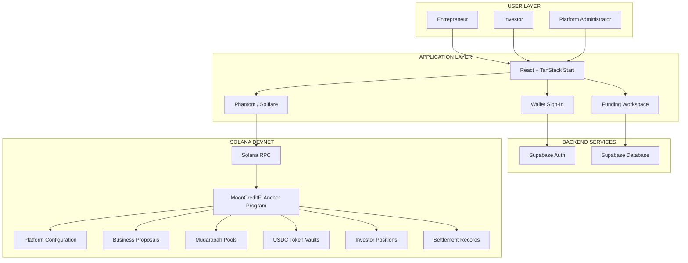
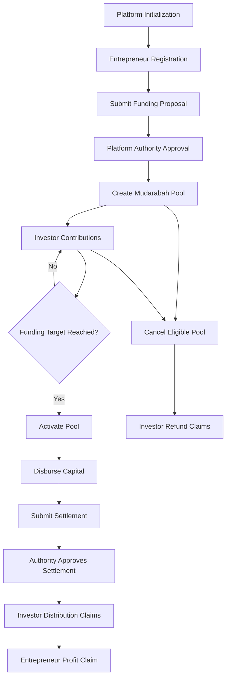

# MoonCreditFi

### Trust-Based Business Funding on Solana

**Capital should follow credible opportunities, not just access to traditional financing.**

MoonCreditFi is a Solana-based decentralized business funding application built around the principles of **Mudarabah** — a profit-sharing partnership between capital providers and entrepreneurs.

It connects entrepreneurs seeking business capital with investors willing to fund promising opportunities under predefined profit-sharing arrangements.

Rather than treating funding as a simple transfer of money, MoonCreditFi creates an on-chain framework for proposals, funding pools, capital contributions, disbursement, settlement, and investor distributions.

**Built on Solana · Anchor Framework · React · TanStack Start · Supabase**

---

## The Problem

Access to business capital remains one of the major barriers facing entrepreneurs, particularly small businesses and early-stage ventures.

Traditional funding channels can create several challenges:

- **Limited access to capital:** Entrepreneurs with viable ideas may struggle to obtain financing because they lack collateral, credit history, or access to established financial institutions.
- **High barriers to participation:** Potential investors may not have accessible ways to participate in structured business funding opportunities.
- **Limited transparency:** Funding arrangements, contributions, and distributions can be difficult to track across fragmented processes.
- **Misaligned funding structures:** Conventional debt financing requires repayment regardless of business performance, which may not suit every entrepreneur or investor.
- **Trust and accountability gaps:** Participants need clearer records of funding commitments, capital movement, and settlement outcomes.

The problem is not simply a shortage of capital. It is the lack of accessible, transparent, and structured ways to connect capital with business opportunities.

## Our Solution

MoonCreditFi provides an on-chain framework for Mudarabah-style business funding.

Entrepreneurs submit funding proposals specifying their business objectives, funding targets, and proposed profit-sharing arrangements.

After platform-authority approval, an entrepreneur can create a funding pool. Investors contribute USDC, and the smart contract records contributions and manages the pool's funding lifecycle.

When the business reaches settlement, the approved returns are distributed according to the agreed profit-sharing structure and the protocol's contract rules.

### How MoonCreditFi works

1. **Propose:** An entrepreneur submits a business funding proposal.
2. **Review:** The platform authority reviews and approves or rejects the proposal.
3. **Create a pool:** An approved entrepreneur creates a funding pool.
4. **Contribute:** Investors contribute USDC to the pool.
5. **Activate and disburse:** Once the funding target is reached, the entrepreneur activates the pool and authorized capital is disbursed.
6. **Settle:** The entrepreneur submits the returned capital and settlement information for platform-authority approval.
7. **Distribute:** Investors claim their calculated distributions, and the entrepreneur claims their eligible profit share.

The smart contract records the relevant operations on Solana, making transaction activity independently inspectable.

## Why Mudarabah?

Mudarabah is a partnership structure in which:

- The investor provides capital.
- The entrepreneur provides business management and effort.
- Profits are shared according to a predefined agreement.
- Financial losses are generally borne by the capital provider, subject to the applicable contractual and Sharia principles, including exceptions involving negligence, misconduct, or breach.

MoonCreditFi uses this structure as the foundation for its funding model.

**Important:** The current smart contract implements predefined profit-sharing and return calculations. It does not independently verify business performance, determine Sharia compliance, or establish whether a reported loss is legitimate. These require additional governance, evidence, legal review, and operational controls.

---

## Product Architecture

MoonCreditFi is designed around three connected layers: the user application, supporting backend services, and Solana smart contracts.

### System architecture



### Technology stack

| Layer | Technology | Responsibility |
|---|---|---|
| Frontend | React 19, TypeScript | User interface |
| Application framework | TanStack Start, Vite | Application routing and rendering |
| Styling | Tailwind CSS | Responsive interface |
| Wallet integration | Solana Wallet Adapter | Phantom and Solflare |
| Smart contracts | Rust, Anchor 0.30.1 | Funding and settlement logic |
| Blockchain | Solana Devnet | On-chain state and transactions |
| Token standard | Classic SPL Token | USDC contributions and distributions |
| Authentication | Supabase Auth | Wallet-based sign-in |
| Supporting storage | Supabase | Application-side data |

### Smart contract architecture

The MoonCreditFi Anchor program manages the core funding lifecycle.



---

## Core Features

### 1. Entrepreneur funding proposals
- Submit business funding proposals.
- Specify funding targets.
- Define the entrepreneur's profit-sharing percentage.
- Track proposal approval status.

### 2. Mudarabah funding pools
- Create pools from approved proposals.
- Accept investor contributions in USDC.
- Enforce funding targets.
- Track pool status and contributed capital.

### 3. On-chain contribution management
- Record investor positions.
- Track individual contributions.
- Use token accounts and program-controlled vaults.
- Inspect transactions using Solana Explorer.

### 4. Capital disbursement
- Activate fully funded pools.
- Require the entrepreneur and platform authority signatures for disbursement.
- Transfer pool capital to the entrepreneur.

### 5. Settlement and distribution
- Submit business settlement returns.
- Require platform-authority approval.
- Calculate investor distributions based on contributions and the agreed profit-sharing ratio.
- Allow eligible entrepreneur profit claims.

### 6. Cancellation and refunds
- Allow eligible pools to be cancelled before disbursement.
- Enable investors to claim refunds from cancelled pools.

---

## Current Development Status

<badge color="success">Devnet prototype</badge>

MoonCreditFi has an Anchor-based Solana program and a React/TanStack frontend configured for Devnet.

| Capability | Current status |
|---|---|
| Solana wallet sign-in | Implemented |
| Supabase authentication | Configured |
| Proposal submission | Implemented |
| Authority-based proposal approval | Smart contract instruction |
| Funding pool creation | Implemented |
| USDC contributions | Implemented |
| Associated token account creation | Supported during contribution |
| On-chain pool and proposal reads | Implemented |
| Capital disbursement | Contract instruction |
| Settlement approval | Contract instruction |
| Investor distributions | Contract instruction |
| Entrepreneur profit claims | Contract instruction |
| Cancellation and refunds | Contract instructions |

**Important distinction:** Not every contract instruction currently has a corresponding frontend workflow. The current user-facing pool workspace exposes proposal submission, approved-pool creation, and contributions. Further workflow integration and end-to-end testing remain necessary.

---

## Devnet Configuration

| Setting | Value |
|---|---|
| Network | Solana Devnet |
| Program ID | `6LVAYFDRrTHSiHZqMWr4tybZNRi755HsoHgeku985pYx` |
| USDC mint | `4zMMC9srt5Ri5X14GAgXhaHii3GnPAEERYPJgZJDncDU` |
| Token program | Classic SPL Token Program |
| Anchor version | 0.30.1 |

Useful links:

- [MoonCreditFi Program on Solana Explorer](https://explorer.solana.com/address/6LVAYFDRrTHSiHZqMWr4tybZNRi755HsoHgeku985pYx?cluster=devnet)
- [Solana Devnet](https://explorer.solana.com/?cluster=devnet)
- [Solana Documentation](https://solana.com/docs)
- [Anchor Documentation](https://www.anchor-lang.com/)

---

## Repository Structure

```text
mooncreditfi/
│
├── frontend/
│   ├── src/
│   │   ├── components/
│   │   ├── routes/
│   │   ├── lib/
│   │   │   ├── platform-capabilities.ts
│   │   │   └── mooncredit-program.ts
│   │   └── idl/
│   │       └── mooncreditfi.json
│   ├── package.json
│   └── vite.config.ts
│
├── programs/
│   └── mooncreditfi/
│       └── src/
│           └── lib.rs
│
├── tests/
├── Anchor.toml
├── Cargo.toml
└── README.md
```

## Getting Started

### Prerequisites

- Node.js and npm
- Rust and Cargo
- Solana CLI
- Anchor CLI 0.30.1
- Phantom or Solflare wallet configured for Devnet
- Supabase project configured for wallet authentication

### Frontend installation

```bash
cd frontend
npm ci
```

Create `frontend/.env.local`:

```dotenv
VITE_SUPABASE_URL=https://your-project.supabase.co
VITE_SUPABASE_PUBLISHABLE_KEY=your-public-publishable-key
```

Start the application:

```bash
npm run dev
```

Open the funding workspace:

```text
http://localhost:3000/pools
```

Use the port printed by Vite if it differs from 3000.

### Frontend verification

```bash
npm test
npm run lint
npm run build
```

### Smart contract build

From the repository root:

```bash
anchor build
```

Run the local test suite:

```bash
anchor test
```

For Devnet operations, explicitly specify the cluster:

```bash
solana config set --url devnet
solana address
solana balance
```

Only deploy after verifying the program ID, deployment keypair, upgrade authority, and intended binary.

---

## Security and Trust Model

MoonCreditFi separates authentication from financial authorization.

- Wallet sign-in proves control of a wallet for an authenticated session.
- A sign-in signature does not authorize a blockchain transaction.
- Every financial transaction must be explicitly signed by the connected wallet.
- Entrepreneur and investor roles are application-level selections, not automatic permissions.
- Proposal approval is restricted to the platform authority.
- Program-controlled token vaults manage pool funds.

### Known limitations

MoonCreditFi is experimental development software and has not been independently audited.

Current limitations include:

- No independent verification of business performance or reported settlement returns.
- No automated identity, fraud, sanctions, or business-document verification.
- No independent Sharia certification.
- Single platform-authority governance.
- Potential rounding dust from integer-based token calculations.
- No time-based funding expiry or emergency pause.
- No Token-2022 support.
- Not every smart contract instruction has a frontend workflow.

These limitations must be addressed before production financial use.

---

## Roadmap

### Phase 1 — Core protocol
- [x] Anchor program implementation
- [x] Devnet program configuration
- [x] Wallet authentication integration
- [x] Proposal submission
- [x] Pool creation and contributions
- [ ] Complete end-to-end funding lifecycle testing

### Phase 2 — Platform expansion
- [ ] Complete investor and entrepreneur dashboards
- [ ] Integrate settlement and distribution workflows
- [ ] Add business documentation and evidence management
- [ ] Add notifications and transaction history
- [ ] Improve pool discovery and investment analytics

### Phase 3 — Trust and governance
- [ ] Independent smart contract security audit
- [ ] Multi-signature platform governance
- [ ] Business verification and due diligence
- [ ] Dispute-resolution framework
- [ ] Independent Sharia review
- [ ] Production security and operational review

### Phase 4 — Ecosystem growth
- [ ] Entrepreneur onboarding
- [ ] Investor partnerships
- [ ] Pilot funding programs
- [ ] Broader Solana ecosystem integrations

---

## Vision

We believe access to capital should not be limited to businesses that already have access to traditional financial institutions.

MoonCreditFi aims to create an accessible funding infrastructure where entrepreneurs can present opportunities, investors can participate in structured partnerships, and funding operations can be transparently tracked on-chain.

**Our goal is to make business funding more accessible, transparent, and aligned with partnership-based financing.**

---

## Disclaimer

MoonCreditFi is currently a Devnet prototype. It is not a production-ready financial service, investment platform, or audited protocol. Do not deposit real funds. Devnet tokens have no real-world monetary value.

Nothing in this repository constitutes investment, legal, financial, or religious advice.

---

**MoonCreditFi — Building a more transparent path from capital to opportunity.**
