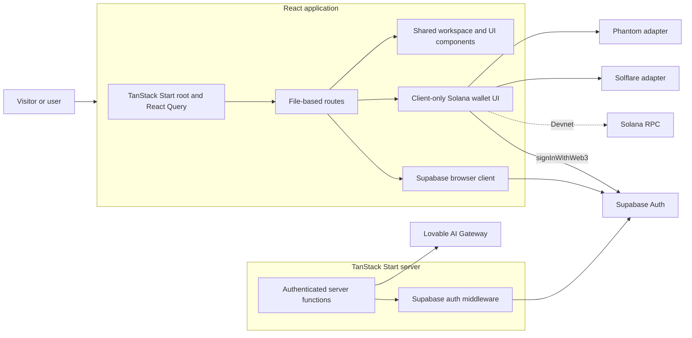
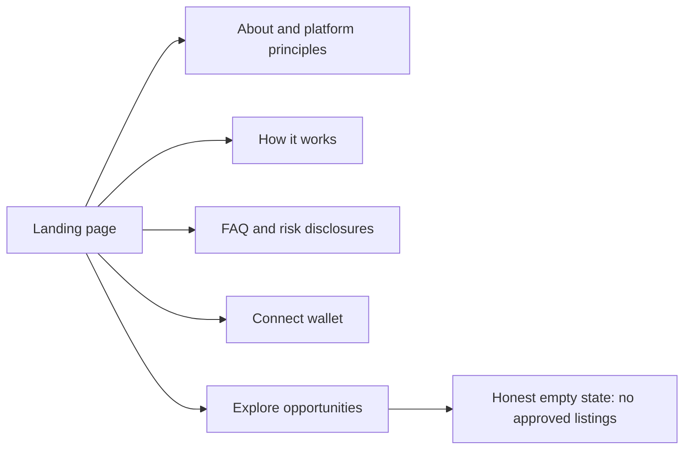
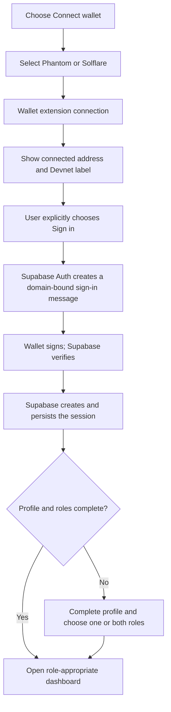

# MoonCreditFi

**Trust Before Capital.** MoonCreditFi is an early-stage platform for reputation-aware Mudarabah business financing. This repository contains the public landing page and application foundations for entrepreneurs and investors.

> **Current status:** The landing page, Supabase native Solana Web3 sign-in, profile/role onboarding, readiness checklist, and Phantom/Solflare connection UI are present. The Supabase Web3 provider and app redirect URLs must be enabled in the Supabase Dashboard. Business records, private document storage, live investment opportunities, and on-chain financial operations are not enabled. The application does not fabricate business, investment, reputation, or transaction data.

## Architecture



### Main code areas

| Area | Responsibility |
| --- | --- |
| `src/routes/` | Public landing, account access, investor and entrepreneur dashboards, opportunities, pools, and authenticated readiness routes |
| `src/components/` | Shared workspace, landing content, wallet UI, and reusable UI primitives |
| `src/components/wallet/` | Phantom/Solflare adapters and wallet controls, loaded client-side to keep browser-only dependencies out of the server worker |
| `src/lib/` | Platform capability gates, profile helpers, readiness server functions, metadata, and shared utilities |
| `src/integrations/supabase/` | Supabase clients, auth middleware, session attachment, and generated database types |
| `src/styles.css` | Global design tokens, landing/workspace styles, and responsive rules |
| `public/` | Static files, including the local landing-page illustration |

`src/routeTree.gen.ts` is generated by TanStack Router; do not edit it manually.

## User and application flows

### Public visitor journey



Visitors can explore the public site without an account. Opportunity and pool pages do not invent listings or accept contributions.

### Wallet and authentication



The wallet UI can connect to Phantom or Solflare, display and copy the address, and disconnect. Sign-in uses `supabase.auth.signInWithWeb3({ chain: "solana", ... })`; the SDK and Supabase Auth handle message signing, verification, session issuance, persistence, refresh, and logout. **Wallet connection alone is not authentication.** Devnet remains the transaction RPC configuration; it is not the Supabase authentication provider setting. Enable **Web3 Wallet → Solana** in Supabase Dashboard → Authentication → Sign In / Providers, and add each app origin to Authentication → URL Configuration → Redirect URLs. If the provider is disabled, sign-in reports the Supabase configuration requirement.

The onboarding route is `/onboarding` and requires an authenticated Supabase session. It saves the current profile and role selection in Supabase Auth user metadata. Users may choose Entrepreneur, Investor, or both. Role-specific routes are `/entrepreneur` and `/dashboard`.

### Routes and access

| Route | Access | Purpose |
| --- | --- | --- |
| `/` | Public | Scrolling landing page |
| `/auth` | Public | Wallet access and Supabase Web3 sign-in |
| `/onboarding` | Authenticated | Profile and initial role selection |
| `/readiness` | Authenticated | Business readiness checklist |
| `/entrepreneur` | Authenticated, Entrepreneur role | Entrepreneur workspace |
| `/dashboard` | Authenticated, Investor role | Investor workspace |
| `/opportunities` | Public | Opportunity marketplace empty state |
| `/pools` | Public | Mudarabah pools unavailable state |

The dashboards show honest empty or unavailable states until real application data and permissions are connected. Frontend navigation is not a substitute for backend authorization.

### Financial workflow status

```mermaid
flowchart LR
  Business[Business registration] -. backend schema and secure storage missing .-> Proposal[Funding proposal]
  Proposal -. reviewer workflow missing .-> Approved[Approved opportunity]
  Approved -. verified Anchor program and Devnet USDC mint missing .-> Contribution[USDC contribution]
  Contribution -. confirmed on-chain event required .-> Reporting[Business reporting and settlement]
  Reporting -. authorized review and contract integration missing .-> Claim[Distribution claim]
```



All wallet authentication, confidential document intake, reputation signals, and contract transactions remain disabled in `src/lib/platform-capabilities.ts`. No program ID, IDL, token mint, balance, score, or successful transaction is fabricated.

## Data and integrations

### Currently connected

- **Supabase Auth:** account/session foundation.
- **Supabase Web3 Auth:** native Solana sign-in; the project provider must be enabled in the Dashboard.
- **Supabase PostgreSQL:** readiness assessment records, subject to the configured project schema and RLS.
- **Lovable AI Gateway:** readiness checklist generation from an authenticated server function.
- **Solana Devnet wallet adapters:** Phantom and Solflare connection UI only.

### Not yet provisioned

- Backend-enforced role tables and private business/investment records.
- Business, ownership, proposal, pool, investment, update, settlement, audit, and notification records.
- Private document storage and upload scanning.
- Verified Anchor program, IDL, and Devnet USDC mint.
- Reviewer authorization and settlement approval.

Profile and role details are stored in the authenticated Supabase user's metadata; the Supabase user ID is used as the readiness record owner. Readiness queries are filtered by that ID, but the database must also enforce `user_id = auth.uid()` through RLS. Confirm or add those policies in Lovable; do not add or edit `drizzle/` or `supabase/migrations/` manually. Do not expose service-role keys or other secrets in browser code.

## Local development

Requirements: Node.js and npm.

```sh
npm install
npm run dev
```

The development server prints its local URL. If the default port is busy, Vite may choose another port.

Configure Supabase using environment variables in a local `.env` file:

```text
VITE_SUPABASE_URL=
VITE_SUPABASE_PUBLISHABLE_KEY=
SUPABASE_URL=
SUPABASE_PUBLISHABLE_KEY=
```

Use the project’s publishable key only. Never commit `.env` or put a service-role key in client-side variables.

## Quality checks

```sh
npm test
npm run lint
npm run build
```

The production build uses the repository’s TanStack Start/Nitro Cloudflare Worker configuration.
