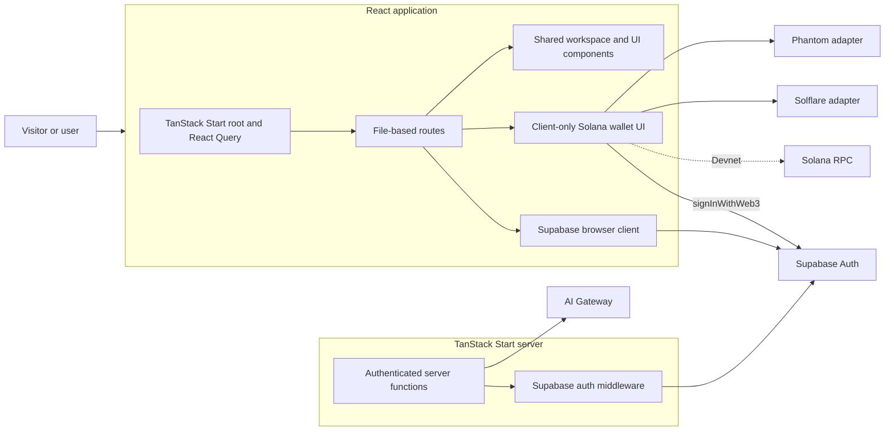
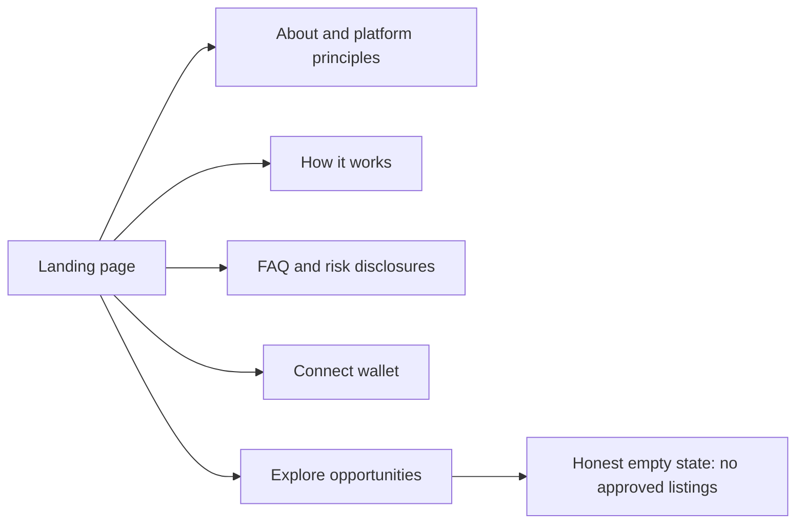
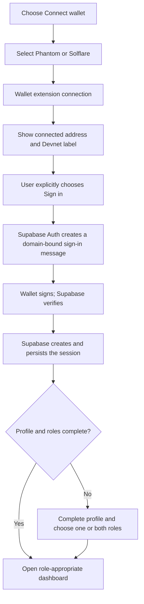
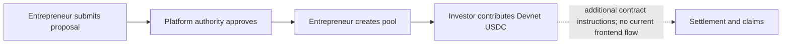

# MoonCreditFi

**Trust Before Capital.** MoonCreditFi is an early-stage platform for reputation-aware Mudarabah business financing. This repository contains the public landing page and application foundations for entrepreneurs and investors.

> **Current status:** The landing page, Supabase native Solana Web3 sign-in, profile/role onboarding, readiness checklist, and Phantom/Solflare connection are available. On Solana Devnet, the pool workspace reads live program configuration, proposals, and pools; entrepreneurs can submit proposals and create pools after platform-authority approval, and investors can contribute Devnet USDC to open pools. Transactions require explicit wallet confirmation. Sign-in does not approve roles or proposals. Entrepreneur business profiles, funding proposal drafts/submission, private document uploads, business reports, and notifications use the included Supabase schema after it is applied to the project. Document scanning and administrative review still require trusted server-side services. The Supabase Web3 provider and app redirect URLs must be enabled in the Supabase Dashboard.

## Architecture



### Main code areas

| Area                         | Responsibility                                                                                                                 |
| ---------------------------- | ------------------------------------------------------------------------------------------------------------------------------ |
| `src/routes/`                | Public landing, account access, investor and entrepreneur dashboards, opportunities, pools, and authenticated readiness routes |
| `src/components/`            | Shared workspace, landing content, wallet UI, and reusable UI primitives                                                       |
| `src/components/wallet/`     | Phantom/Solflare adapters and wallet controls, loaded client-side to keep browser-only dependencies out of the server worker   |
| `src/lib/`                   | Platform capability gates, profile helpers, readiness server functions, metadata, and shared utilities                         |
| `src/integrations/supabase/` | Supabase clients, auth middleware, session attachment, and generated database types                                            |
| `src/styles.css`             | Global design tokens, landing/workspace styles, and responsive rules                                                           |
| `public/`                    | Static files, including the local landing-page illustration                                                                    |

`src/routeTree.gen.ts` is generated by TanStack Router; do not edit it manually.

## User and application flows

### Public visitor journey



Visitors can explore the public site without an account. The opportunities page shows an empty state when there are no approved listings. The pools page reads Devnet pool and proposal accounts, supports entrepreneur proposal submission and approved-pool creation, and accepts contributions to open pools.

### Wallet and authentication



The wallet UI can connect to Phantom or Solflare, display and copy the address, and disconnect. Sign-in uses `supabase.auth.signInWithWeb3({ chain: "solana", ... })`; the SDK and Supabase Auth handle message signing, verification, session issuance, persistence, refresh, and logout. **Wallet connection alone is not authentication.** Devnet remains the transaction RPC configuration; it is not the Supabase authentication provider setting. Enable **Web3 Wallet → Solana** in Supabase Dashboard → Authentication → Sign In / Providers, and add each app origin to Authentication → URL Configuration → Redirect URLs. If the provider is disabled, sign-in reports the Supabase configuration requirement.

The onboarding route is `/onboarding` and requires an authenticated Supabase session. It saves the current profile and role selection in Supabase Auth user metadata. Users may choose Entrepreneur, Investor, or both. Role-specific routes are `/entrepreneur` and `/dashboard`.

### Routes and access

| Route            | Access                           | Purpose                                                           |
| ---------------- | -------------------------------- | ----------------------------------------------------------------- |
| `/`              | Public                           | Scrolling landing page                                            |
| `/auth`          | Public                           | Wallet access and Supabase Web3 sign-in                           |
| `/onboarding`    | Authenticated                    | Profile and initial role selection                                |
| `/readiness`     | Authenticated                    | Business readiness checklist                                      |
| `/entrepreneur`  | Authenticated, Entrepreneur role | Entrepreneur workspace                                            |
| `/dashboard`     | Authenticated, Investor role     | Investor workspace                                                |
| `/opportunities` | Public                           | Opportunity marketplace; empty until approved listings exist      |
| `/pools`         | Public                           | Live Devnet pools, entrepreneur proposals, and USDC contributions |

The dashboards show honest empty or unavailable states until real application data and permissions are connected. Frontend navigation is not a substitute for backend authorization. Proposal approval is performed by the platform authority; it is not automated by sign-in or the pool page.

### Financial workflow status



The frontend pool workflow uses the Devnet program ID, bundled Anchor IDL, and configured USDC mint. The page checks the on-chain config and mint, displays live pool/proposal data, and links confirmed transactions to Solana Explorer. No business descriptions, identity checks, reputation scores, or transaction successes are fabricated. Verify the complete deployed instruction/account ABI before relying on transactions.

## Data and integrations

### Currently connected

- **Supabase Auth:** account/session foundation.
- **Supabase Web3 Auth:** native Solana sign-in; the project provider must be enabled in the Dashboard.
- **Supabase PostgreSQL:** readiness assessments and owner-scoped business profiles, funding proposals, document metadata, business reports, notification preferences, and notifications. Apply the workspace schema below before using the workspace pages.
- **Supabase Storage:** private business-document bucket with owner-folder policies, provisioned by the same schema script.
- **Transaction history:** investor activity reads confirmed/finalized rows from `indexed_transactions`; a trusted server-side indexer must write these records.
- **AI Gateway:** readiness checklist generation from an authenticated server function.
- **Solana Devnet / Anchor:** program config and pool/proposal reads, proposal submission, approved-pool creation, and USDC contributions through Phantom or Solflare.

### Not yet provisioned

- Backend-enforced role tables and investment records.
- A trusted document malware scanner and reviewer service.
- A server-side transaction indexer; without it, portfolio history shows an honest empty state.
- Business verification and reputation signals.
- A reviewer-facing proposal approval interface; the deployed platform authority remains responsible for approvals.
- Frontend flows for pool activation, capital disbursement, settlement, investor claims, entrepreneur profit claims, and refunds.

Profile and role details are stored in the authenticated Supabase user's metadata. The platform records migration enforces owner isolation with RLS; frontend role checks do not replace backend authorization. Business reports are entrepreneur-submitted statements, not verified financial statements. Do not expose service-role keys or other secrets in browser code.

### Apply the workspace database schema

In the Supabase Dashboard for the same project configured in the app, open **SQL Editor**, create a query, paste the contents of [`supabase/migrations/20261126000100_platform_records.sql`](./supabase/migrations/20261126000100_platform_records.sql), and run it. It creates the business, proposal, private document metadata, report, notification, notification-preference, indexed transaction, and audit tables; applies row-level security and workflow guards; and provisions the private `mooncredit-business-documents` Storage bucket with owner-folder access policies. It does not create an indexer or reviewer service. Run it with an authorized project owner account and inspect any SQL errors before using the workspace.
Readiness records are filtered by the authenticated Supabase user ID; confirm the project enforces `user_id = auth.uid()` through RLS before relying on the feature. Do not expose service-role keys or other secrets in browser code.

## Local development

Requirements: Node.js and npm.

```sh
npm install
npm run dev
```

The development server prints its local URL. If the default port is busy, Vite may choose another port.

Configure Supabase using environment variables in a local `.env` file:

```text
VITE_SUPABASE_URL=
VITE_SUPABASE_PUBLISHABLE_KEY=
SUPABASE_URL=
SUPABASE_PUBLISHABLE_KEY=
```

Use the project’s publishable key only. Never commit `.env` or put a service-role key in client-side variables.

## Quality checks

```sh
npm test
npm run lint
npm run build
```

The production build uses the repository’s TanStack Start/Nitro Cloudflare Worker configuration.
